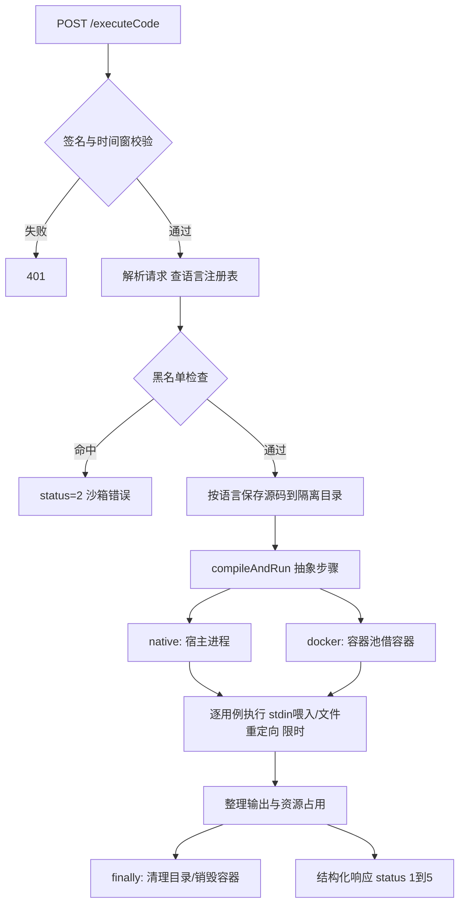

# lianoj-code-sandbox

> 独立代码沙箱服务：安全地编译并执行不可信代码，返回结构化执行结果

   

为在线判题系统（配套微服务后端仓库）提供代码执行能力的独立服务，也可用于任何需要"提交代码 → 拿到输出与资源占用"的场景。它**只负责执行，不负责判题**——比对答案、判定资源超限、计分都在判题服务完成，这个边界让沙箱可以被单独部署、单独扩展、单独加固。

核心能力：

- **多语言**：Java / C++ / Python，语言差异（源码文件名、编译/运行命令、镜像、时限系数）收敛在语言注册表，新增语言以配置为主；
- **双实现**：原生进程（宿主机，零依赖、快）与 Docker 容器（cgroup 资源限制、断网、用后销毁），配置一行切换；
- **签名鉴权**：执行资源不能被任意调用方使用——请求需携带摘要签名与时间戳；
- **容器池 + 编译缓存**：预热容器、相同源码复用编译产物，压缩热路径框架开销；
- **Windows 支持**：适配 Docker Desktop 的命名管道传输与 exec 输入通道限制（详见下文）。

---

## 架构与执行流程



沙箱与判题服务之间的**结构化状态协议**（异常绝不以 500 错误页返回，避免调用方误读）：

| status | 含义 |
| --- | --- |
| 1 | 执行成功（输出供比对） |
| 2 | 沙箱错误（黑名单拦截 / 环境异常） |
| 3 | 运行错误 |
| 4 | 编译错误 |
| 5 | 执行超时（沙箱层强杀） |

## API

### `GET /health` —— 健康检查

### `POST /executeCode` —— 执行代码

请求头：`X-Timestamp`（毫秒时间戳）、`X-Sign`（签名）；请求体：

```json
{
  "language": "java",
  "code": "import java.util.Scanner;public class Main{public static void main(String[] a){Scanner sc=new Scanner(System.in);System.out.println(sc.nextInt()+sc.nextInt());}}",
  "inputList": ["1 2", "5 6"]
}
```

响应（judgeInfo 含耗时 ms 与内存 KB）：

```json
{
  "outputList": ["3", "11"],
  "status": 1,
  "judgeInfo": { "time": 388, "memory": 1256 }
}
```

### 签名协议

```
X-Timestamp = 当前毫秒时间戳
X-Sign      = md5( secretKey + "." + 请求体原文 + "." + timestamp )
```

一次签名提供四重防护：**防伪造**（密钥不随请求传输）、**防篡改**（请求体参与摘要，改动一个字符即失效）、**防重放**（时间戳超出 60 秒窗口拒绝）、**防时序侧信道**（`MessageDigest.isEqual` 恒时比较）。

实现要点：服务端以 `@RequestBody String` 接收**字节级原文**参与校验（先绑定对象再重新序列化会因字段顺序差异误拒），且**先验签后解析**——恶意报文不会进入参数解析与执行流程。生产化升级路径：HMAC-SHA256 + 一次性 nonce + HTTPS。

调用示例（Git Bash）：

```bash
SECRET="your-secret-key"
BODY='{"language":"java","code":"...","inputList":["1 2"]}'
TS=$(date +%s000)
SIGN=$(printf '%s' "$SECRET.$BODY.$TS" | md5sum | cut -d' ' -f1)
curl -s -X POST http://localhost:8090/executeCode \
  -H "Content-Type: application/json" -H "X-Timestamp: $TS" -H "X-Sign: $SIGN" \
  --data-raw "$BODY"
```

## 双实现对比

| 维度 | native（原生进程） | docker（容器） |
| --- | --- | --- |
| 程序运行 | 宿主机子进程 | 受限容器内 exec |
| 资源约束 | `-Xmx256m`、超时强杀（destroy → destroyForcibly 升级） | 容器内存 300MB + memorySwap 同值（等效禁 swap）+ 单核 + 断网 |
| 内存统计 | 无（判题侧跳过 MLE 判定） | docker stats 采样峰值，字节→KB 上报 |
| 输入传递 | 向进程 stdin 写入后关闭（EOF 契约） | 输入落文件拷入容器，`sh -c "... < /app/input_N.txt"` 重定向 |
| 隔离强度 | 弱（靠黑名单 + JVM 参数） | 文件系统/网络/资源隔离，容器用后即销毁 |
| 适用 | 本机调试、快速联调 | 推荐生产路径 |

切换方式：`application.yaml` 中 `sandbox.type: native | docker`。

**为什么 Docker 模式下 Java 仍在宿主编译**：编译产物随工作目录拷入容器执行——宿主编译可命中编译缓存并与原生模式共享缓存逻辑，同时避免容器内再起一个编译 JVM 的开销。

## 安全分层

| 层 | 机制 | 边界（诚实声明） |
| --- | --- | --- |
| 接口层 | 签名鉴权 + 时间窗 | 60 秒窗口内同一请求仍可重放（无 nonce）；发送端密钥当前为源码常量，生产应配置化 |
| 源码层 | 17 词 DFA 字典树黑名单（命令执行/文件 IO/网络/脚本引擎） | 可被反射、编码、拼接绕过——只是低成本前置闸门 |
| 运行层 | 超时强杀、cgroup 内存限额、断网、独立工作目录 | CPU 未配 quota（withCpuCount 不能视为硬配额）；共享宿主内核 |
| 回收层 | finally 清理目录 + 容器用后强制销毁 | 清理失败仅记日志 |

尚未实现：非 root 运行、只读根文件系统、seccomp 系统调用白名单、pids/输出/磁盘配额——这是生产级沙箱（isolate/nsjail 一类）的差距所在，已列入规划。

## 容器池与编译缓存

- **容器池**：启动时预热 2 个 Java 镜像容器（保活主进程 `tail -f /dev/null`——判题镜像默认 CMD 均为一次性命令，不显式保活则容器启动即退出）；判题借用（借出前校验容器仍存在）、用后销毁保证文件系统纯净；池空按需创建。只预热 Java 池是取舍：主力语言高频命中，低频语言常驻预热不划算。
- **编译缓存**：`SHA-256(源码 + 语言)` 为键复用编译产物。覆盖面：native 的 Java/C++ 与 Docker 的 Java（宿主编译路径）；Docker 的 C++ 在容器内编译、Python 解释执行，不走此缓存。缓存键未包含编译器版本等环境指纹，工具链升级后需失效——列入规划。

## Windows 真机适配（踩坑实录）

在 Windows + Docker Desktop（WSL2 后端）上真机联调时解决的代表性问题：

1. **命名管道传输**：Docker Desktop 经 `npipe` 暴露守护进程，docker-java 默认回退的 Jersey 不支持该协议——显式引入 `docker-java-transport-zerodep`（内置 NamedPipeSocket）；
2. **exec 写 stdin 损坏连接**：对照探针验证后确认 exec 的双向流（hijack + stdin）在命名管道上必现"管道已结束"——输入改为文件重定向，exec 退化为单向输出流；
3. **输出契约统一**：原生路径 `readLine + join` 无末尾换行、Docker 按帧拼接带 `\n`——在沙箱出口统一格式，避免严格比对的调用方误判；
4. **内存单位链路**：docker stats 字节 → 沙箱 KB 上报 → 判题侧与 MB 限值换算比较，任何一层口径错误都会造成"全部误判"。

## 快速开始

```yaml
# application.yaml
server:
  port: 8090
sandbox:
  type: docker        # native | docker
  auth:
    secretKey: your-secret-key   # 与调用方保持一致
```

Docker 模式需提前准备镜像：

```bash
docker pull eclipse-temurin:8-jdk-alpine
docker tag eclipse-temurin:8-jdk-alpine openjdk:8-alpine   # 代码按 openjdk:8-alpine 引用
docker pull gcc:latest
docker pull python:3.11-alpine
```

启动后验证：`curl http://localhost:8090/health` 返回 `ok`；docker 模式启动日志应出现"创建判题容器 ×2 + 容器池预热完成"。

## 测试

```bash
mvn test    # 3 项沙箱端到端回归测试
```

## 已知边界与规划

- 退出码未参与状态判定（非零退出且 stderr 为空可能被判成功）、原生路径超时标记存在被 stderr 覆盖的分支——规划引入结构化退出原因；
- 内存为约 1Hz 采样峰值，亚秒级短程序可能漏采；规划读取 cgroup `memory.peak` 或进程级 `getrusage`；
- 黑名单对 C++/Python 仅是文本匹配，非语言级分析；
- 编译缓存并发发布非严格原子、未校验产物完整性——规划发布互斥与完成标记。

## 配套仓库

| 仓库 | 定位 |
| --- | --- |
| `lianoj-code-sandbox`（本仓库） | 独立代码沙箱服务 |
| `lianoj-backend-microservice` | 微服务后端：判题编排、比对策略、消息可靠性（沙箱的主要调用方） |
| `lian-oj-backend` | 单体版本：系统演进起点 |
